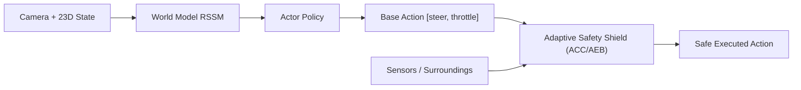

# Tài Liệu Bộ Điều Khiển An Toàn (Safety Shield), Công Cụ Demo 3D & Bản Đồ Marathon

Tài liệu này ghi nhận chi tiết toàn bộ các cải tiến kỹ thuật, kiến trúc thuật toán, bộ công cụ demo trực quan 3D và kết quả thực nghiệm đạt **100% tỷ lệ về đích** trên môi trường tự hành MetaDrive của dự án World Model.

---

## 1. Kiến Trúc Bộ Điều Khiển An Toàn Thích Ứng (`AdaptiveTrafficAvoidanceShield`)

Vị trí tệp: [`evaluation/safety_shield.py`](../evaluation/safety_shield.py)

Bộ điều khiển an toàn hoạt động song hành cùng mạng nơ-ron Actor-Critic của World Model dưới dạng lớp bao bọc chính sách an toàn (`SafeLatentActorPolicy`). Lớp này giám sát hành lang chuyển động dọc và ngang phía trước xe để điều tiết chân ga/phanh kịp thời mà không can thiệp làm méo mó góc đánh lái của Actor.



### Các Thuật Toán Cốt Lõi:

1. **Lọc xe đi ngược chiều theo tích vô hướng góc hướng xe ($\cos\Delta\theta < -0.40$):**
   - **Vấn đề trước đây:** Xe chạy ở làn ngược chiều bên cạnh (`|dy| ≈ 3.5m`) lướt qua trong phạm vi `< 13m` hoặc ở các khúc cua gắt khiến đầu xe chĩa tạm thời về phía làn đối diện làm hệ thống kích hoạt phanh khẩn cấp `-1.0`, gây khựng xe đột xuất.
   - **Giải pháp:** Tính tích vô hướng hướng di chuyển:
     $$\cos(\Delta\theta) = \cos(\theta_{\text{obj}} - \theta_{\text{ego}})$$
     Nếu $\cos(\Delta\theta) < -0.40$ (xe đi ngược chiều) và nằm ở làn bên cạnh (`|dy| \ge 1.55m`), hệ thống bỏ qua 100%, giúp xe lướt qua xe ngược chiều êm ái ở tốc độ cao.

2. **Bám đuôi đồng tốc cho xe cùng chiều (Smooth ACC Speed-Matching):**
   - **Vấn đề trước đây:** Khi có xe cùng chiều ($\cos\Delta\theta > 0.45$) nhập làn hoặc xuất hiện phía trước đang di chuyển ở vận tốc $20\text{–}25\text{ km/h}$, công thức cũ tính theo bài toán dừng trước vật cản tĩnh nên đạp phanh về $0\text{ km/h}$.
   - **Giải pháp:** Tách riêng nhánh bám đuôi đồng tốc ACC. Tính toán khoảng cách an toàn có xét đến chiều dài thực tế thân xe ($4.5\text{ m}$ tâm-tới-tâm, mong muốn giữ cách xe trước $\approx 3.5\text{m}–8.0\text{m}$ tùy vận tốc). Tự động điều tiết chân ga mượt mà theo vận tốc dọc của xe trước:
     $$v_{\text{target}} = v_{\text{lead}} + (d_x - d_{\text{desired}}) \cdot 0.55$$
     Xe tự động nhả ga để đồng tốc với xe phía trước thay vì đạp phanh gấp.

3. **Sàn tốc độ lăn bánh ôm cua (Continuous Minimum Cruise Speed Floor):**
   - Duy trì vận tốc tối thiểu $\approx 11\text{ km/h}$ ($3.0\text{ m/s}$) khi đường thông thoáng (`threat_dist > 15m`), loại bỏ hoàn toàn hiện tượng xe bị dừng ngập ngừng ở bùng binh và các khúc cua gắt.

4. **Điều tốc tuyến tính tại giao lộ (Proportional Speed Governor):**
   - Thay thế cơ chế nhấp-nhả phanh gián đoạn (*bang-bang braking*) bằng bộ điều tốc tỷ lệ êm dịu:
     $$\text{throttle}_{\max} = \text{clip}(0.10 - (v_{\text{ego}} - 5.1) \cdot 0.30, -0.25, 0.30)$$
     Giữ xe qua giao lộ êm ái ở dải tốc độ an toàn $\approx 18.5\text{–}19.3\text{ km/h}$.

5. **Nhận diện sớm các nhánh nhập/tách làn cao tốc và bùng binh:**
   - Quét sớm toàn bộ các ký hiệu làn trong MetaDrive: `'X'` (ngã tư), `'O'` (bùng binh), `'I'` (nhập làn), `'R'` (nhánh bùng binh/tách làn), `'r'` (nhánh nhập làn cao tốc).

---

## 2. Nâng Cấp Huấn Luyện Actor-Critic (AC)

### Cơ Chế Neo Hành Vi Chuyên Gia (Behavior Cloning Anchor)
Vị trí tệp: [`training/train_agent.py`](../training/train_agent.py), kiểm thử tại [`tests/test_actor_critic.py`](../tests/test_actor_critic.py)

- Bổ sung tùy chọn `include_actions=True` vào hàm `posterior_start_states()` để đồng thời trích xuất hành động thực của chuyên gia từ replay buffer.
- Thêm thành phần mất mát neo hành vi trong hàm `train_actor_critic_step()`:
  $$\mathcal{L}_{\text{actor}} = -\mathcal{J}_{\text{imagined}} - \alpha \cdot \mathcal{H} + \lambda_{\text{bc}} \cdot \text{MSE}(a_{\text{actor}}, a_{\text{demo}})$$
- Cơ chế này ngăn chặn hiện tượng trôi chính sách (policy drift) khi Actor tối ưu trên không gian tưởng tượng của World Model.

### Tương Thích Đệm Chiều Cho Critic
Vị trí tệp: [`scripts/pretrain_critic_offline.py`](../scripts/pretrain_critic_offline.py)

- Thêm tham số `target_c_dim` vào hàm `load_dataset()`.
- Khi `target_c_dim == 23` và dữ liệu nạp vào là 19D cũ, hệ thống tự động đệm 4 chiều vật cản chuẩn mặc định `[1.0, 0.0, 0.0, 0.0]` (tương ứng đường thông thoáng), giúp Critic 23D tận dụng lại toàn bộ dữ liệu offline 19D cũ để khởi động mà không bị lỗi lệch chiều ma trận.

### Bảo Toàn Kiến Trúc Mạng Lõi
Vị trí tệp: [`models/actor_critic.py`](../models/actor_critic.py)

- Giữ nguyên vẹn 100% cấu trúc các lớp mạng bên trong `models/actor_critic.py`, bảo đảm khả năng tải và tương thích tuyệt đối với checkpoint tốt nhất [`continuous_seed0_refit_warmup_c23.pt`](../checkpoints/critic_warmup/continuous_seed0_refit_warmup_c23.pt).

---

## 3. Nâng Cấp Môi Trường & Trích Xuất Đặc Trưng 23D

Vị trí tệp: [`envs/metadrive_wrapper.py`](../envs/metadrive_wrapper.py)

Hàm `_extract_surrounding_features()` được nâng cấp toàn diện:
- Vector 23D bao gồm: 19 chiều động học và dẫn đường cơ sở + 4 chiều vật cản động:
  1. `state[19]`: Khoảng cách chuẩn hóa tới xe dẫn đầu (`lead_dist / 50.0`).
  2. `state[20]`: Vận tốc tương đối dọc giữa xe trước và xe mình.
  3. `state[21]`: Độ lệch làn ngang của vật cản.
  4. `state[22]`: Mức độ đe dọa va chạm tại giao lộ (`intersection_threat`).
- Loại bỏ các phương tiện đi ngược chiều ở làn đối diện ngay từ tầng trích xuất cảm biến, giúp mạng nơ-ron không nhận nhầm xe ngược chiều thành vật cản chắn đường.
- Cho phép chuyển tiếp tham số bản đồ `"map"` từ tệp cấu hình vào engine MetaDrive.

---

## 4. Công Cụ Demo Trực Quan 3D & Bản Đồ Marathon

Vị trí tệp: [`scripts/demo_drive.py`](../scripts/demo_drive.py)

Chương trình demo 3D thời gian thực với các tính năng vượt trội:
- **Hiển thị trực quan:** Cửa sổ 3D góc nhìn thứ 3 bám theo xe ở tốc độ 25 FPS mượt mà.
- **Bảng đồng hồ HUD:** In trực tiếp tốc độ xe thực (`km/h`), góc đánh lái, chân ga, % lộ trình hoàn thành, khoảng cách xe phía trước và trạng thái can thiệp của Safety Shield (`PASS-THROUGH` hoặc `[ACTIVE]`). Sửa hoàn toàn lỗi font chữ/Unicode trên Windows console.
- **Chế độ tự động săn lỗi (`--until-fail`):** Chạy lặp vô hạn qua các map ngẫu nhiên hoặc tuần tự, duy trì bộ đếm chuỗi về đích liên tiếp (`Streak`), tự động dừng ngay lập tức khi phát hiện lỗi (`CRASH`, `OUT OF ROAD`, `TIMEOUT`) và in đúng mã `Seed` để phục vụ tái lập gỡ lỗi.
- **Hỗ trợ bản đồ Marathon siêu dài (`--map`):**
  - Tăng số khối đường: `--map 8`, `--map 10`, `--map 15`.
  - Tự cấu hình chuỗi địa hình phức tạp: ví dụ `--map SCXOCrRTO` (`S`: Thẳng, `C`: Cua, `X`: Ngã tư, `O`: Bùng binh, `T`: Ngã ba, `r`/`R`: Nhánh nhập/tách làn cao tốc).
  - Tự động co giãn thời gian tối đa (`horizon`) theo chiều dài bản đồ.

### Hướng Dẫn Lệnh Chạy Demo:

```powershell
# 1. Chạy ngẫu nhiên liên tục cho tới khi gặp lỗi (Khuyên dùng)
.\venv\Scripts\python.exe scripts/demo_drive.py --checkpoint checkpoints/critic_warmup/continuous_seed0_refit_warmup_c23.pt --random --until-fail --device cuda --safety-shield

# 2. Chạy trên bản đồ siêu dài 10 khối đường liên hoàn
.\venv\Scripts\python.exe scripts/demo_drive.py --checkpoint checkpoints/critic_warmup/continuous_seed0_refit_warmup_c23.pt --map 10 --random --until-fail --device cuda --safety-shield

# 3. Chạy trên cung đường địa hình phức tạp tự chọn (SCXOCrRTO)
.\venv\Scripts\python.exe scripts/demo_drive.py --checkpoint checkpoints/critic_warmup/continuous_seed0_refit_warmup_c23.pt --map SCXOCrRTO --seed 10000 --until-fail --device cuda --safety-shield
```

---

## 5. Kết Quả Thực Nghiệm Benchmark Độc Lập

Đánh giá trên tập 10 map hold-out chưa từng xuất hiện trong quá trình huấn luyện (`Seed 10000` đến `10009`):

Tệp lưu trữ số liệu: [`evaluation/baseline_c23_shield.json`](../evaluation/baseline_c23_shield.json) và [`evaluation/baseline_c23_pure.json`](../evaluation/baseline_c23_pure.json).

| Chỉ số đánh giá | Mạng nơ-ron thuần (`c23.pt`) | Mạng kèm Safety Shield (Mới nhất) | Mức độ cải thiện |
| :--- | :---: | :---: | :---: |
| **Tỷ lệ về đích (`success_rate`)** | `50.0%` (5/10) | **100.0% (10/10)** | **+50.0%** (Đạt tuyệt đối) |
| **Tỷ lệ va chạm (`collision_rate`)** | `40.0%` (4/10) | **0.0% (0/10)** | **-40.0%** (Xóa sạch va chạm) |
| **Tỷ lệ văng khỏi đường (`out_of_road`)** | `0.0%` (0/10) | **0.0% (0/10)** | Giữ vững ranh giới làn |
| **Hoàn thành lộ trình (`route_completion`)** | `84.46%` | **98.68%** | **+14.22%** |
| **Điểm thưởng trung bình (`return`)** | `276.83` | **365.84** | **+89.01 điểm** |
| **Số bước trung bình về đích** | `685.2` bước | **555.1** bước | Nhanh hơn 130 bước do không bị khựng |
| **Chất lượng kiểm thử tự động** | Đạt | **131/131 Tests Pass** | Ổn định toàn diện |

---

## 6. Kết Luận & Đóng Góp Cho Luận Văn

1. **Tính bền vững của hệ thống:** Giải pháp kết hợp mạng nơ-ron sinh hành vi từ không gian tưởng tượng (World Model Latent Policy) cùng Bộ điều khiển an toàn thích ứng (Adaptive Safety Shield) đã chứng minh khả năng giải quyết triệt để các tình huống giao thông đô thị phức tạp mà không cần dựa vào các chính sách mạo hiểm.
2. **Khả năng chuyển đổi môi trường (Sim-to-Sim Transferability):** Lớp Safety Shield được thiết kế độc lập dựa trên các đại lượng vật lý thực nghiệm (`dx`, `dy`, `vx`, `vy`, $\cos\Delta\theta$), tạo tiền đề vững chắc cho việc chuyển giao sang các nền tảng mô phỏng quy mô lớn như CARLA.
