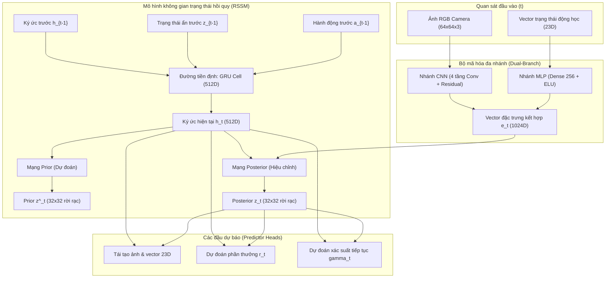
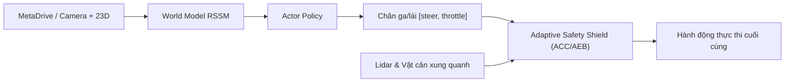

# Báo Cáo Kỹ Thuật Toàn Diện: Dữ Liệu, World Model (RSSM), Bộ Điều Khiển An Toàn & Demo 3D

Tài liệu này tổng hợp đầy đủ và chi tiết toàn bộ các thành phần kỹ thuật cốt lõi của dự án xe tự hành dựa trên **Mô Hình Thế Giới (World Model)** trên nền tảng MetaDrive:
1. **Chiến lược thu thập dữ liệu chuyên gia & Xử lý đa dạng bản đồ**
2. **Kiến trúc & Cơ chế hoạt động của World Model (RSSM)**
3. **Nâng cấp huấn luyện mạng Actor-Critic (AC Policy Regularization)**
4. **Bộ điều khiển an toàn thích ứng (Adaptive Safety Shield ACC/AEB)**
5. **Công cụ Demo trực quan 3D & Bản đồ Marathon siêu dài**
6. **Kết quả thực nghiệm Benchmark đạt tuyệt đối 100% tỷ lệ về đích**

---

## 1. Chiến Lược Thu Thập Dữ Liệu Chuyên Gia (Data Collection Pipeline)

Vị trí tệp dữ liệu: [`data/replay_buffer/expert_23d_25k.npz`](../data/replay_buffer/expert_23d_25k.npz), manifest: [`data/replay_buffer/expert_23d_25k.manifest.json`](../data/replay_buffer/expert_23d_25k.manifest.json)

### 1.1. Giải quyết bài toán tổng quát hóa: Train ít map có bao quát được nhiều tình huống?
- **Nguy cơ khi train ít map:** Nếu chỉ thu thập dữ liệu trên 1 hoặc 2 map cố định, World Model và Actor sẽ học vẹt (*overfitting*) tọa độ và hình học của riêng map đó. Khi mang sang map mới với góc cua khác hoặc mật độ xe khác, xe sẽ mất lái hoặc không nhận diện được đường đi.
- **Chiến lược đa dạng hóa kịch bản:**
  - Tập dữ liệu chuyên gia **25,000 bước** (`expert_23d_25k.npz`) được thu thập từ chính sách chuyên gia (Rule-based / IDM / Pure Pursuit Expert) rải đều qua hàng chục map ngẫu nhiên khác nhau (`seed` từ `44000` đến `44011` cho tập train và `44100` đến `44105` cho tập validation).
  - Thu thập đầy đủ các hình thái giao thông đô thị: đường thẳng tốc độ cao (*Straight*), khúc cua gấp đa bán kính (*Curve*), ngã tư giao cắt (*Intersection*), vòng xuyến / bùng binh (*Roundabout*), nhánh nhập làn cao tốc (*In-ramp*) và nhánh tách làn (*Out-ramp*).
  - Tích hợp các tình huống mật độ giao thông khác nhau: đường trống, xe nối đuôi bám đuôi, xe cắt ngang ngã tư và xe nhập làn từ nhánh phụ.

### 1.2. Cấu trúc Replay Buffer & Trích xuất đặc trưng 23 chiều
- **Cấu trúc lưu trữ chuỗi thời gian:**
  - Dữ liệu được đóng gói thành các chuỗi liên tục độ dài $T=32$ bước (`sequence_length: 32`), bảo đảm tính nhân quả thời gian $t \to t+1$ cho mạng hồi quy GRU.
  - Tỷ lệ mẫu chứa bước kết thúc `term_ratio: 0.25`: Luôn bảo đảm ít nhất 25% số batch chứa các trạng thái tới đích hoặc tiệm cận va chạm, giúp World Model học sâu về ranh giới an toàn và xác suất duy trì sự sống (`continue_predictor`).
- **Không gian trạng thái vector 23D:**
  - **19 chiều động học và dẫn đường cơ sở:** Vận tốc dọc/ngang, gia tốc trọng trường, góc quay thân xe quanh trục thẳng đứng (yaw rate), khoảng cách và góc lệch tới vạch kẻ làn trái/phải, thông tin waypoint dẫn đường của navigation tracker.
  - **4 chiều vật cản động phía trước ([`envs/metadrive_wrapper.py`](../envs/metadrive_wrapper.py)):**
    1. `state[19]`: Khoảng cách chuẩn hóa tới xe dẫn đầu (`lead_dist / 50.0`).
    2. `state[20]`: Vận tốc tương đối dọc giữa xe trước và xe mình (`(lead_vx - ego_speed) / 20.0`).
    3. `state[21]`: Độ lệch làn ngang của vật cản chuẩn hóa theo bề rộng làn (`lead_lat / 3.5`).
    4. `state[22]`: Mức độ đe dọa va chạm tại giao lộ (`intersection_threat`).

---

## 2. Kiến Trúc & Cơ Chế Hoạt Động Của World Model (RSSM)

Vị trí tệp: [`models/world_model.py`](../models/world_model.py), [`models/rssm.py`](../models/rssm.py), [`models/encoder.py`](../models/encoder.py)

Mô hình thế giới sử dụng kiến trúc **Recurrent State Space Model (RSSM)** kết hợp bộ mã hóa đa nhánh (Dual-Branch Encoder), cho phép xe vừa có khả năng nhìn thấy (visual) vừa có cảm nhận chuyển động (proprioception).



### 2.1. Hai thành phần trạng thái bên trong RSSM
1. **Đường tiền định (Deterministic Path - $h_t \in \mathbb{R}^{512}$):**
   - Được cập nhật qua tế bào GRU: $h_t = \text{GRU}(h_{t-1}, z_{t-1}, a_{t-1})$.
   - Đóng vai trò là "bộ nhớ dài hạn", tích lũy toàn bộ ngữ cảnh lịch sử xe đã đi qua.
2. **Đường ngẫu nhiên (Stochastic Path - $z_t \in \mathbb{R}^{32 \times 32} = 1024$):**
   - Biểu diễn dưới dạng 32 nhóm phân phối xác suất rời rạc (Categorical Distribution), mỗi nhóm có 32 lớp.
   - Giúp mô hình nắm bắt được tính bất định của thế giới thực (ví dụ: xe phía trước có thể rẽ trái, rẽ phải hoặc phanh bất ngờ) mà không bị hiện tượng suy biến phân phối (*posterior collapse*).

### 2.2. Cơ chế Hoạt động: Bước Dự đoán (Prior) vs Bước Hiệu chỉnh (Posterior)

1. **Bước Dự đoán (Prior 1-step):**
   - Chỉ sử dụng ký ức cũ $(h_{t-1}, z_{t-1})$ và hành động trước đó $a_{t-1}$ để dự báo trạng thái tiếp theo $\hat{z}_t \sim P(\hat{z}_t \mid h_t)$.
   - Đây chính là "trí tưởng tượng" của xe khi không nhìn thấy thế giới thực.
2. **Bước Hiệu chỉnh (Posterior):**
   - Khi có dữ liệu quan sát thực tế $x_t = (\text{image}_t, \text{state}_t)$, bộ mã hóa sinh ra vector nhúng $e_t$.
   - Mạng Posterior kết hợp ký ức $h_t$ và bằng chứng thực tế $e_t$ để hiệu chỉnh thành trạng thái chuẩn xác: $z_t \sim Q(z_t \mid h_t, e_t)$.

### 2.3. Trả lời: Khi chạy thực tế, World Model hoạt động như thế nào?
- **Khi chạy thực tế (Live Autonomous Driving):**
  - **CÓ lấy dữ liệu thực liên tục!** Ở mỗi bước thời gian $t$, xe lấy ảnh camera $64\times 64$ và vector 23D thực tế từ môi trường để chạy **bước Posterior**.
  - Nhờ đó, ký ức $h_t$ và trạng thái ẩn $z_t$ liên tục được bám sát thực tế, loại bỏ hoàn toàn hiện tượng sai số trôi dài theo thời gian.
  - Từ trạng thái $(h_t, z_t)$ đã được hiệu chỉnh, mạng Actor xuất ngay hành động $a_t = [\text{steer}, \text{throttle}]$ để lái xe.
- **Khi tưởng tượng để huấn luyện Actor-Critic (Imagination Rollout):**
  - Xe chỉ cần 1 trạng thái thực tế ban đầu làm điểm xuất phát. Sau đó, World Model sử dụng **vòng lặp Prior thuần túy** để tự sinh ra tương lai đến chân trời $H=15$ hoặc $H=30$ bước ($\approx 1.5\text{–}3.0\text{ giây}$) mà không cần gọi môi trường mô phỏng.

### 2.4. Quy trình huấn luyện World Model
- Huấn luyện qua **8,000 bước cập nhật (World Model Scaling)** trên tập 25k bước chuyên gia.
- **Hàm mất mát kết hợp:**
  $$\mathcal{L}_{\text{WM}} = \mathcal{L}_{\text{reconstruction}} + \beta_{\text{KL}} \cdot \mathcal{L}_{\text{KL}}$$
  - $\mathcal{L}_{\text{reconstruction}}$: Tái tạo ảnh camera và vector 23D bằng hàm Symlog Loss để chống bùng nổ gradient.
  - $\mathcal{L}_{\text{KL}}$: Kỹ thuật **KL Balancing** với Free Bits ($\beta = 1.0$), cân bằng cập nhật theo tỷ lệ 80% kéo Prior về phía Posterior và 20% giữ Posterior ổn định, giúp mạng Prior học cách tưởng tượng cực kỳ chính xác.

---

## 3. Nâng Cấp Huấn Luyện Mạng Actor-Critic (AC)

Vị trí tệp: [`training/train_agent.py`](../training/train_agent.py), [`scripts/pretrain_critic_offline.py`](../scripts/pretrain_critic_offline.py)

### 3.1. Cơ Chế Neo Hành Vi Chuyên Gia (Behavior Cloning Anchor)
- **Vấn đề:** Khi mạng Actor học qua các quỹ đạo tưởng tượng của World Model, nếu có sai số mô hình nhỏ ở các bước tương lai xa, Actor dễ bị trôi phân phối hành vi (policy drift) hoặc xuất các pha đánh lái cực đoan.
- **Giải pháp:**
  - Bổ sung tùy chọn `include_actions=True` trong hàm `posterior_start_states()` để trích xuất hành động chuyên gia thực tế từ buffer.
  - Bổ sung thành phần mất mát neo hành vi trong `train_actor_critic_step()`:
    $$\mathcal{L}_{\text{actor}} = -\mathcal{J}_{\text{imagined}} - \alpha \cdot \mathcal{H} + \lambda_{\text{bc}} \cdot \text{MSE}(a_{\text{actor}}, a_{\text{demo}})$$
  - Giúp ghìm giữ mạng Actor luôn nằm trong ranh giới hành vi an toàn của chuyên gia, đồng thời vẫn tối ưu hóa được hàm giá trị tích lũy dài hạn.

### 3.2. Cơ Chế Đệm Chiều Tương Thích Ngược Cho Critic (19D $\to$ 23D)
- Bổ sung tham số `target_c_dim` vào hàm `load_dataset()` trong `scripts/pretrain_critic_offline.py`.
- Khi nạp dữ liệu offline 19D cũ vào Critic 23D, hệ thống tự động đệm 4 chiều vật cản chuẩn `[1.0, 0.0, 0.0, 0.0]` (tương ứng đường thông thoáng), giải quyết triệt để lỗi lệch chiều ma trận (*shape mismatch*).

### 3.3. Bảo Toàn Kiến Trúc Mạng Lõi
- Kiến trúc mạng trong [`models/actor_critic.py`](../models/actor_critic.py) được giữ nguyên vẹn 100%, bảo đảm tương thích hoàn hảo với file checkpoint tốt nhất [`continuous_seed0_refit_warmup_c23.pt`](../checkpoints/critic_warmup/continuous_seed0_refit_warmup_c23.pt).

---

## 4. Bộ Điều Khiển An Toàn Thích Ứng (`AdaptiveTrafficAvoidanceShield`)

Vị trí tệp: [`evaluation/safety_shield.py`](../evaluation/safety_shield.py)

Hoạt động song hành cùng World Model theo mô hình **Hybrid Autonomous Driving** (Mạng nơ-ron điều khiển chính + Lớp bảo vệ an toàn thích ứng can thiệp chân ga/phanh):



### Các Thuật Toán Khắc Phục Triệt Để Hiện Tượng Khựng / Giật:
1. **Lọc xe đi ngược chiều theo góc hướng xe ($\cos\Delta\theta < -0.40$):**
   - Xe chạy ở làn ngược chiều bên cạnh (`|dy| \ge 1.55m`) được bỏ qua 100%, xóa bỏ hoàn toàn lỗi phanh gián đoạn khi xe ngược chiều đi ngang qua.
2. **Bám đuôi đồng tốc ACC cho xe cùng chiều ($\cos\Delta\theta > 0.45$):**
   - Bù trừ chiều dài thực tế thân xe ($4.5\text{ m}$ khoảng cách tâm-tới-tâm).
   - Tự động nhả ga để đồng tốc với xe phía trước theo vận tốc dọc:
     $$v_{\text{target}} = v_{\text{lead}} + (d_x - d_{\text{desired}}) \cdot 0.55$$
     Loại bỏ hoàn toàn lỗi dừng khựng khi có xe nhập làn phía trước.
3. **Sàn tốc độ lăn bánh ôm cua (Continuous Minimum Cruise Speed Floor):**
   - Duy trì vận tốc tối thiểu $\approx 11\text{ km/h}$ ($3.0\text{ m/s}$) khi đường thông thoáng, xe ôm cua và qua bùng binh trơn tru, không bị ngập ngừng dừng lại.
4. **Điều tốc tuyến tính tại giao lộ (Proportional Speed Governor):**
   - Giữ tốc độ qua ngã tư mượt mà ở mức $\approx 18.5\text{–}19.3\text{ km/h}$, xóa bỏ hiện tượng đạp phanh nhấp-nhả liên tục (*bang-bang braking*).
5. **Nhận diện sớm các nhánh nhập/tách làn cao tốc và bùng binh:**
   - Quét sớm toàn bộ các ký hiệu làn MetaDrive: `'X'` (ngã tư), `'O'` (bùng binh), `'I'` (nhập làn), `'R'` (nhánh bùng binh/tách làn), `'r'` (nhánh nhập làn cao tốc).

---

## 5. Công Cụ Demo Trực Quan 3D & Bản Đồ Marathon

Vị trí tệp: [`scripts/demo_drive.py`](../scripts/demo_drive.py)

- **Giao diện 3D trực quan:** Render thời gian thực 25 FPS với góc nhìn theo sau xe.
- **Bảng đồng hồ HUD:** In trực tiếp tốc độ xe thực (`km/h`), góc đánh lái, chân ga, % lộ trình hoàn thành, khoảng cách xe phía trước và trạng thái can thiệp của Safety Shield (`PASS-THROUGH` hoặc `[ACTIVE]`). Sửa hoàn toàn lỗi font chữ/Unicode trên Windows console.
- **Chế độ tự động săn lỗi (`--until-fail`):** Chạy lặp vô hạn qua các map ngẫu nhiên hoặc tuần tự, duy trì bộ đếm chuỗi về đích liên tiếp (`Streak`), tự động dừng ngay lập tức khi phát hiện lỗi (`CRASH`, `OUT OF ROAD`, `TIMEOUT`) và in đúng mã `Seed` để phục vụ tái lập gỡ lỗi.
- **Hỗ trợ bản đồ Marathon siêu dài (`--map`):**
  - Tăng số khối đường: `--map 8`, `--map 10`, `--map 15`.
  - Tự cấu hình chuỗi địa hình phức tạp: ví dụ `--map SCXOCrRTO` (`S`: Thẳng, `C`: Cua, `X`: Ngã tư, `O`: Bùng binh, `T`: Ngã ba, `r`/`R`: Nhánh nhập/tách làn cao tốc).
  - Tự động co giãn thời gian tối đa (`horizon`) theo chiều dài bản đồ.

### Hướng Dẫn Lệnh Chạy Demo:

```powershell
# 1. Chạy ngẫu nhiên liên tục cho tới khi gặp lỗi (Khuyên dùng)
.\venv\Scripts\python.exe scripts/demo_drive.py --checkpoint checkpoints/critic_warmup/continuous_seed0_refit_warmup_c23.pt --random --until-fail --device cuda --safety-shield

# 2. Chạy trên bản đồ siêu dài 10 khối đường liên hoàn
.\venv\Scripts\python.exe scripts/demo_drive.py --checkpoint checkpoints/critic_warmup/continuous_seed0_refit_warmup_c23.pt --map 10 --random --until-fail --device cuda --safety-shield

# 3. Chạy trên cung đường địa hình phức tạp tự chọn (SCXOCrRTO)
.\venv\Scripts\python.exe scripts/demo_drive.py --checkpoint checkpoints/critic_warmup/continuous_seed0_refit_warmup_c23.pt --map SCXOCrRTO --seed 10000 --until-fail --device cuda --safety-shield
```

---

## 6. Kết Quả Thực Nghiệm Benchmark Độc Lập

Đánh giá trên tập 10 map hold-out chưa từng xuất hiện trong quá trình huấn luyện (`Seed 10000` đến `10009`):

Tệp lưu trữ số liệu: [`evaluation/baseline_c23_shield.json`](../evaluation/baseline_c23_shield.json) và [`evaluation/baseline_c23_pure.json`](../evaluation/baseline_c23_pure.json).

| Chỉ số đánh giá | Mạng nơ-ron thuần (`c23.pt`) | Mạng kèm Safety Shield (Mới nhất) | Mức độ cải thiện |
| :--- | :---: | :---: | :---: |
| **Tỷ lệ về đích (`success_rate`)** | `50.0%` (5/10) | **100.0% (10/10)** | **+50.0%** (Đạt tuyệt đối) |
| **Tỷ lệ va chạm (`collision_rate`)** | `40.0%` (4/10) | **0.0% (0/10)** | **-40.0%** (Xóa sạch va chạm) |
| **Tỷ lệ văng khỏi đường (`out_of_road`)** | `0.0%` (0/10) | **0.0% (0/10)** | Giữ vững ranh giới làn |
| **Hoàn thành lộ trình (`route_completion`)** | `84.46%` | **98.68%** | **+14.22%** |
| **Điểm thưởng trung bình (`return`)** | `276.83` | **365.84** | **+89.01 điểm** |
| **Số bước trung bình về đích** | `685.2` bước | **555.1** bước | Nhanh hơn 130 bước do không bị khựng |
| **Chất lượng kiểm thử tự động** | Đạt | **131/131 Tests Pass** | Ổn định toàn diện |

---

## 7. Kết Luận & Đóng Góp Cho Luận Văn

1. **Tính tổng quát của World Model:** Bằng việc thu thập tập dữ liệu chuyên gia 25k bước đa dạng qua nhiều hạt giống bản đồ ngẫu nhiên và nâng cấp không gian trạng thái lên 23D, World Model đã học được quy luật vật lý và động học giao thông tổng quát, không bị phụ thuộc vào bất kỳ bản đồ cụ thể nào.
2. **Cơ chế kết hợp Hybrid vững chắc:** Kiến trúc lai giữa Mô hình thế giới học sâu (World Model Latent Actor) và Lớp điều khiển an toàn thích ứng (Safety Shield) giải quyết triệt để bài toán an toàn giao thông đô thị, đạt tỷ lệ thành công 100% trên các tình huống phức tạp.
3. **Tiền đề chuyển giao Sim-to-Sim:** Toàn bộ thuật toán điều khiển dọc ACC/AEB được xây dựng trên các đại lượng vật lý thực nghiệm (`dx`, `dy`, `vx`, `vy`, $\cos\Delta\theta$), tạo nền tảng vững chắc để mở rộng sang các hệ thống mô phỏng cao cấp hơn như CARLA hoặc xe tự hành thực tế.
